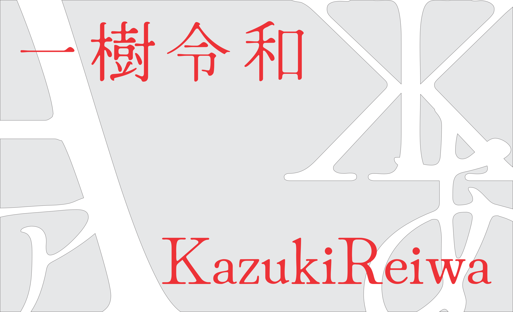
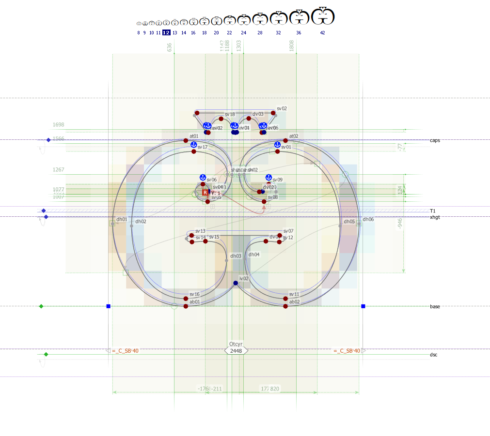

# KazukiReiwa

**A comprehensive, open-source font family supporting Latin, Cyrillic, Japanese, Greek, and Braille scripts**

[Download](#-download) • [Features](#-features) • [Supported Scripts](#-supported-scripts) • [Changelog](#-changelog) • [License](#-license)

---

## 📖 Overview

**KazukiReiwa** is a free and open-source font family designed to provide comprehensive typographic support for multiple writing systems. The project aims to deliver a unified, high-quality typeface that supports Latin, Cyrillic, Japanese, Greek, and Braille scripts with extensive Unicode coverage.

The font family includes intelligent OpenType features, automatic diacritic positioning, and optimized kerning for professional typography across diverse linguistic contexts.

## ✨ Features

- **Multi-Script Support**: Comprehensive coverage for Latin, Cyrillic, Japanese, Greek, and Braille
- **Unicode Coverage**: Extensive character set including diacritics, symbols, and linguistic markers
- **Smart Typography**: Automatic diacritic positioning and optimized kerning
- **Variable Font**: Full weight range with variable font support
- **Multiple Weights**: Thin, ExtraLight, Light, Regular, Medium, SemiBold, Bold, ExtraBold, and Black
- **Open Source**: Licensed under SIL Open Font License (OFL)
- **Production Ready**: Optimized for both screen and print applications

## 🌍 Supported Scripts

<strong>Click to view examples for each supported script</strong>

| Latin | Cyrillic | Greek | Japanese | Braille |
|:-----:|:--------:|:-----:|:--------:|:-------:|
|  |  |  |  |  |

### Script Details

- **Latin**: Complete Latin alphabet with numbers, punctuation, and comprehensive diacritic support
- **Cyrillic**: Full Cyrillic script coverage for Russian and other Cyrillic-based languages
- **Greek**: Complete Greek alphabet with modern and classical variants
- **Japanese**: Hiragana, Katakana, and Kanji support
- **Braille**: Braille pattern characters for accessibility

## 📦 Font Weights

KazukiReiwa is available in the following weights:

| Weight | Style | Variable Font |
|--------|-------|---------------|
| Thin | 100 | ✅ |
| ExtraLight | 200 | ✅ |
| Light | 300 | ✅ |
| Regular | 400 | ✅ |
| Medium | 500 | ✅ |
| SemiBold | 600 | ✅ |
| Bold | 700 | ✅ |
| ExtraBold | 800 | ✅ |
| Black | 900 | ✅ |

## 📥 Download

### Official Sources

- **GitHub Releases**: [Latest Release](https://github.com/Adhamura/KazukiReiwa/releases/latest)
- **Official Website**: [kazukikimura.com](https://www.kazukikimura.com)
- **Email**: [kazuki.kimura.jp@gmail.com](mailto:kazuki.kimura.jp@gmail.com)

### Installation

1. Download the font files from the [releases page](https://github.com/Adhamura/KazukiReiwa/releases/latest)
2. Extract the archive
3. Install the font files (`.ttf` or `.otf`) through your operating system's font installer
4. Restart applications to use the new font

## 📝 Changelog

### Version History

#### 2024
- **September 2**: Fixed layer connections and compatibility improvements for all weights
- **July 29**: Variable font support released for all weights
- **June 21**: Released Thin, ExtraLight, Light, Medium, Regular, Bold, SemiBold, ExtraBold, and Black weights

#### 2022
- **January 24**: Fixed ascending/descending metrics, reformatted Bold and Light versions, adjusted character width for Latin characters
- **January 20**: Released Light, Medium, and Bold weights

#### 2021
- **December**: Refactored hinting and kerning
- **November**: Added Japanese script support
- **January**: Added Braille script support; fixed kerning and size for small PPM

#### 2020
- **December**: Added Greek script support
- **November**: Added Russian (Cyrillic) script support
- **September**: Initial release with basic Latin letters, numbers, and punctuation

## 🎨 Typography Features

### OpenType Features

- **Automatic Diacritic Positioning**: Smart font routines optimize diacritic placement for arbitrary base+diacritic combinations
- **Kerning Pairs**: Extensive kerning tables for professional typography
- **Ligatures**: Contextual ligatures for improved readability
- **Number Styles**: Multiple number formatting options

### Technical Specifications

- **Format**: OpenType (TTF/OTF)
- **Variable Font**: Yes (2024+)
- **Hinting**: Optimized for screen rendering
- **Character Set**: Unicode-compliant with extensive coverage

## 👤 Designer

**Kazuki Kimura**

Professional type designer specializing in multi-script font development and typography systems.

## 📄 License

This font is licensed under the **SIL Open Font License (OFL)**, version 1.1.

### License Summary

- ✅ **Free to use** for personal and commercial projects
- ✅ **Free to modify** and distribute
- ✅ **No attribution required** (though appreciated)
- ❌ **Cannot be sold** as a standalone product
- ❌ **Cannot redistribute** under a different license

For complete license terms, see:
- [OFL.txt](OFL.txt) - Full license text
- [OFL-FAQ.txt](OFL-FAQ.txt) - Frequently asked questions

## 🤝 Contributing

Contributions, suggestions, and feedback are welcome! Please feel free to:

- Report issues or bugs
- Suggest new features or improvements
- Submit pull requests
- Share your use cases and examples

## 📧 Contact

- **Website**: [kazukikimura.com](https://www.kazukikimura.com)
- **Email**: [kazuki.kimura.jp@gmail.com](mailto:kazuki.kimura.jp@gmail.com)
- **GitHub**: [@Adhamura](https://github.com/Adhamura)

## ⭐ Acknowledgments

Thank you to all users, contributors, and supporters of the KazukiReiwa font project. Your feedback and usage help drive continuous improvement.

---

**Made with dedication to typography and open-source principles**

